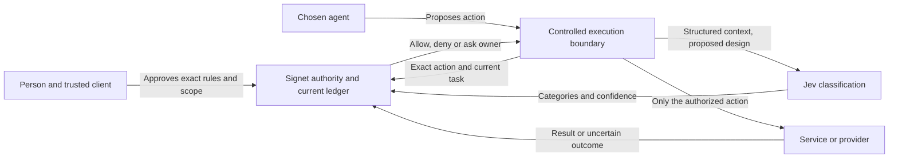

# Signet: personal authority across services

Design checkpoint: October 11, 2026. Created by [Jeremy McEntire](https://perardua.dev).
**Concept and preserved research prototype. Further implementation is paused.**
This document records the intended architecture, decisions already made and work
that would be required to make it a service. It is not a production guarantee,
platform integration announcement or commitment to build the remaining system.

## Why it exists

A person should choose an agent that represents them across services. Each
service having its own agent does not solve that person's need for consistent
permission, privacy and control. Signet proposes an authority boundary that can
outlive a particular model or host: what may this worker do, using which asset,
for which task, under which conditions, and until when?

An agent supplies judgment and proposes actions. Signet evaluates authority.
An isolated executor or controlled browser performs only an authorized action.
The owner can permit routine work, require approval, deny a class of action or
consider a specific exception. A good explanation is not itself permission.

The controlled execution/Jev portion is proposed, not implemented. An agent
that retains a separate unrestricted browser, shell or service credential can
bypass this diagram. A plugin alone cannot force a host's native tools through it.

## Rings, rules, assets and assignments

These are separate concepts and records:

| Concept | Meaning |
|---|---|
| Rule | Versioned conditions governing spending, disclosure or credential use. |
| Asset | A versioned reference to a card, identity field/document or credential, with explicit provider, account and supported capability origin. No secret belongs in its descriptive metadata. |
| Ring | A binding between exact rule versions and exact asset versions. A label is not authority. |
| Assignment/delegation | Owner-approved scope for one worker key and task: permitted ring versions, budget, operation count, deadline and bounded swap rights. |
| Activation | The worker's use of an approved ring within that assignment. Defining a ring never activates it. |

A new account starts with the zero-permissions ring only. No vacation budget,
card or replenishment permission is seeded. Examples appear only when requested.
A travel planner and a dog-food worker can have simultaneous, separate assignments.
Where they share a budget, reservations and completed spending count together;
changing rings or cards cannot reset that total. Mandatory global restrictions
still apply. Permission to use a credential does not imply reveal, export or rotate.

Assignments end on task completion or their explicit expiry, whichever comes
first. No default duration was chosen. No automatic renewal exists. Bounded
swaps may be approved in advance, but cannot extend the original activation
deadline, bypass global restrictions or undo task completion. Revocation stops
new work; started operations require reconciliation. See [rings and assets](rings-and-assets.md).

## Decisions and exceptions

The intended execution outcomes are **allow**, **approval required**, or **deny**.
An eligible denied/over-budget action can separately offer **request an exception**;
that is a proposal path, not a fourth execution permission.

Example: the agent says dog food costs $5 more this month and explains why it is
needed. The proposal must show the exact purchase, breached rule, requested delta,
currency, total, remaining allowance, requested scope and expiry. The owner chooses
whether this covers one purchase, a bounded monthly allowance, or an explicit
standing-rule edit. Those choices are not interchangeable. Do not invent a live
balance or treat approval for one purchase as permission for the entire month.

The agent's rationale and evidence remain untrusted claims. Pending proposals
cannot execute. Approved exceptions need an audited grant with atomic redemption,
original intent identity and no duplicate approval, replay or allowance stacking.
The preserved SQLite authority implements exact one-time action/rule approvals.
The richer monthly exception/escalation workflow is **planned**, not implemented.

## Native state and recovery

The selected persistence direction is private R2 with native JSON, not a SQL
translation layer. Immutable snapshots are named
`<user_hash>.<contenthash>.json`; a small head pointer changes through an exact
ETag conditional write. Every transition reads current state, validates its scope,
creates the immutable candidate, then attempts the head CAS. A losing writer
cannot dispatch. Ring state, budgets, nonces, receipts and native owner passkey
counters/revocations are stored in one aggregate.

Historical snapshots may be inspected. Execution must use current authority.
Restoring old policy content creates a new monotonic version; it must never
restore spent grants, budgets, completed tasks or receipts. A successful head
write with a lost reply is recovered by its exact receipt and original execution
ID. A recovered result is not fresh dispatch authority. Unknown provider outcomes
retain reservations until a reviewed reconciliation process establishes the truth.

Retention requires both an age cutoff and N newer committed versions, while
preserving active, pinned and in-flight references. Neither cutoff nor N is
chosen. Cleanup remains separately privileged and unimplemented. Hashes alone
do not prevent an administrator from rolling back the head; a protected monotonic
checkpoint and disaster recovery design remain open. [Persistence details](r2-persistence.md).

## Client custody

The owner supplies the asset encryption key. There is no escrow or asset-key
recovery. Losing it means re-uploading the asset; account/passkey recovery does
not recover encrypted assets. Fresh strong authentication gates creation,
replacement and rotation; rotation also requires the current asset key.

The chosen direction is client-only decryption: the server returns ciphertext,
not the asset key or plaintext. A trusted client is distinct from the agent.
Exactly which client contribution unlocks which operation is unresolved. The
proposed handshake has designated pairs at each stage, not an arbitrary two-of-three
quorum: client authorizes agent and server, server verifies client authorization
plus agent proof, then a separate client contribution is needed to unlock/use.
No bespoke threshold scheme has been selected or implemented.

Single-use redemption can be enforced in the ledger. A copied raw key, PAN or
password cannot be made to expire in the agent's memory. Candidate routes use an
isolated component that returns a bounded result, or provider-enforced limited
credentials such as suitably restricted virtual cards. A virtual PAN is not
inherently single-use. Supported merchant, amount and expiry controls must be
verified with the actual provider. No universal merchant coverage is assumed.

A separate process with agent-readable memory, environment, files or logs is
insufficient isolation. Unattended cloud work needs an available trusted client
or a valid provider-delegated route. The local AES-GCM primitive is implemented;
enrollment, broker isolation and the handshake remain open. The legacy server's
plaintext `vault.json` mnemonic path is a deployment blocker for this custody
model. [Custody details](client-asset-custody.md).

## Controlled browser and Jev: agreed direction, open security design

Reuse a real browser engine, with Chromium automation a candidate, rather than
building an engine. The intended sequence is: pause the action, classify relevant
behavior, evaluate the current ring in Signet, then execute only the exact allowed
action. Approval can be automatic within existing rules; it need not mean another
human prompt. Existing authenticated sessions, saved cards and one-click checkout
must pass the gate, even when no fresh website login occurs.

Jev is TypeSafe's non-text-generating System One model: it evaluates state and
typed questions with Noul, Choice and Score results. It is a candidate semantic
classifier, not the source of authority. See [TypeSafe's introduction](https://docs.typesafe.ai/introduction).
Use structured, minimized text context; current Jev state input is text/JSON,
not direct image understanding. [State documentation](https://docs.typesafe.ai/concepts/state).

TypeSafe documents numeric/date weaknesses and susceptibility to adversarial
content, distracting context and option order in Jev 1.13. Schema-valid output
is not guaranteed semantic correctness. Keep amounts, deadlines, identities,
revocation and redemption deterministic. Evaluate false negatives, abstention,
consequence-sensitive thresholds and prompt injection. A missed category cannot
create an unchecked route; unknown or unsupported actions must stop.
[Documented limitations](https://docs.typesafe.ai/model-jaggedness/jev-1.13).

Open enforcement questions include scripts and background requests, popups,
service workers, downloads, redirects, cookies, session exports, debugging
interfaces and alternative agent tools. Dynamic pages and anti-bot systems
limit reliable automation; CAPTCHA or checkout may require the person. No
anti-bot evasion, universal unattended checkout or Jev integration is implemented.

## Where the prototype stops

[Prototype status](prototype-status.md) is the implementation inventory and test
record. The smallest coherent demonstration is the fictional website/owner
preview plus exact one-time approval and synthetic rings lifecycle tests. No
live merchant, personal-agent platform or Jev account is connected. Existing
code is preserved for evaluation, not presented as a launched product.

A partner or funded implementation effort could resolve the remaining work in
[open implementation questions](open-work.md). Publishing this concept would
record Jeremy's contribution and design; it would not establish exclusivity,
certification, outside endorsement or a likelihood of acquisition.
