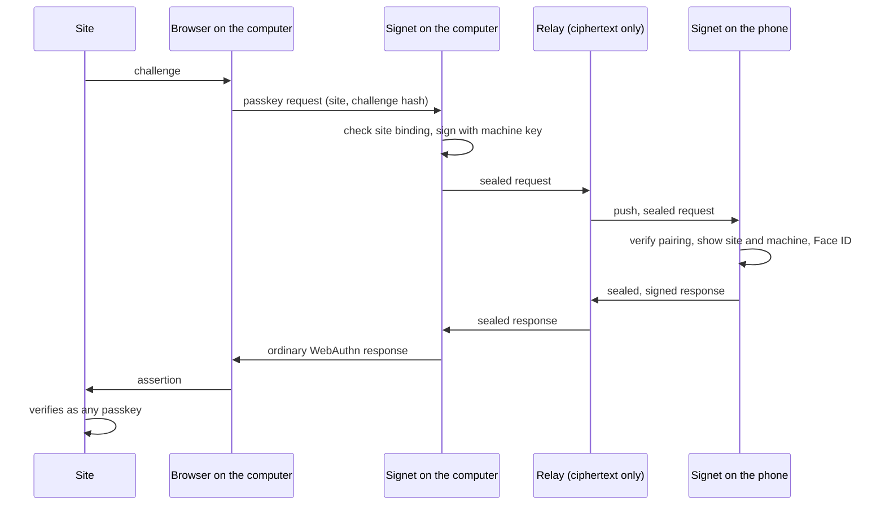

# Remote passkey approval: the phone signs, the computer relays

Status: design plus a first tested slice, November 26, 2026. Created by
[Jeremy McEntire](https://perardua.dev). Build resumed **for this slice only**, at
Jeremy's direction; everything else in [open work](open-work.md) stays paused.
The `signet-passkey` crate implements the protocol core described here. Its 37
tests pass, including full create and sign-in ceremonies verified by an
independent WebAuthn implementation (webauthn-rs), all with keys generated at
test time. There is no phone app, desktop integration or relay yet. No real
passkey was enrolled and nothing was deployed.

## The problem

A computer asks for a passkey. Its owner is 800 miles away with the phone that
holds it. Wi-Fi and Bluetooth are both on, and the sign-in still fails, because
the cross-device passkey flow requires the phone to be within Bluetooth range of
the computer that asked.

That proximity check is deliberate. It stops an attacker's computer, anywhere on
the internet, from getting a victim to approve a sign-in on it. It also assumes
the person sits next to the machine doing the work. Agents end that assumption:
the work runs on a machine at home, in an office or in a data center while the
owner is somewhere else.

The approval has to travel to the owner. The owner should not have to travel to
the machine.

## What cannot be done

A passkey held by the operating system (iCloud Keychain, Windows Hello) is
unlocked by the operating system checking the user locally, with a fingerprint,
face or device password. No interface lets a remote signal satisfy that check,
and none should. So an existing platform passkey cannot be approved from far
away. Signet has to be the authenticator.

## Design

| Role | What it is | What it holds |
|---|---|---|
| Authenticator | Signet on the phone | Passkey private keys, behind Face ID. Decides and signs. |
| Requester | Signet on the computer | A machine identity key. Holds no passkey key. Forwards requests, returns results. |
| Relay | Store-and-forward service | Nothing useful. Sees only sealed messages and which pairing they belong to. |
| Site | Any WebAuthn relying party | The public key, as with any passkey. Needs no change. |

The computer gets its requests one of two ways:

- **Operating-system passkey provider.** macOS 14 and later let a third-party app
  supply passkeys to Safari, Chrome and native apps; Windows 11 has an equivalent
  plugin interface, generally available since November 2025. The system hands the
  provider the site identifier and a hash of the client data, never the page.
- **Browser extension plus a local Signet process.** The extension takes over the
  page's passkey calls, the way password-manager extensions do, and passes them to
  Signet over native messaging. It works in any Chromium browser on any operating
  system, including one an agent drives on a Linux host.

The phone shows four things before Face ID: the site, the action (sign in, or
create a passkey), the account, and which paired machine is asking. It signs only
the request it showed.

## What replaces proximity

Bluetooth answered one question: is the machine asking one the owner is actually
using? These checks answer it without distance.

| Attack | What stops it |
|---|---|
| A stranger's computer asks the phone to sign in somewhere | Only paired machines can ask. Pairing is a one-time ceremony the owner performs; every request is signed by the machine's key and the phone rejects any other signer. |
| A phishing page on a paired machine asks for the real site's passkey | The site identifier must match the page's origin. The browser or OS enforces that in the provider path. In the extension path Signet enforces it itself, using the public-suffix list and the origin reported by the browser, never one supplied by the page. The phone repeats the check when it is given the origin. |
| The relay, or anyone on the network, reads, alters, replays or swaps messages | Messages are signed, then sealed to the recipient's key (HPKE, RFC 9180). The relay cannot read or forge them. Requests expire in two minutes and are accepted once. A response is bound to the digest of the exact request it answers. |
| The relay substitutes its own key while a new passkey is created | The response must be signed by the paired phone. The computer discards anything else before the site ever sees it. |
| A stored passkey is used for a different site | The phone signs only when the request's site identifier equals the one the passkey was created for. |
| Someone who glimpses a pairing ticket pairs in the owner's place | After pairing, both devices show a six-digit code derived from the two devices' keys. If another device answered the ticket, the codes differ and the owner revokes the pairing. |

## What it does not protect

- **A compromised paired machine** can ask for any site. The phone shows the site
  and the machine, and the owner can decline, but a tired owner may not. Requests
  from an agent should say so, and a short code shown on both ends is a candidate
  addition.
- **What happens after sign-in.** A session cookie on a compromised machine is
  outside this design, as it is for every passkey.
- **A lost or compromised phone.** See Keys, below.
- **Availability.** If the phone is off or unreachable, nothing signs. That is the
  intended failure.

## Keys

Every key in this subsystem is P-256, because that is the curve the phone's Secure
Enclave, the Mac's Secure Enclave and Windows TPMs hold. This departs from
Signet's Ed25519 identities and is confined to this subsystem.

- **Passkeys, hardware-bound.** Generated inside the phone's Secure Enclave and
  never exportable. Strongest. A lost phone loses them, so each account needs a
  second authenticator or its own recovery route.
- **Passkeys, portable.** An ordinary P-256 key encrypted under a Secure Enclave
  key. Weaker, but it can be backed up and exported. Imported passkeys are always
  this class, because the Secure Enclave cannot import a key that was created
  elsewhere.
- **Identity keys.** The phone and each machine have a signing key and a key
  for sealing. The phone's live in the Secure Enclave; a machine's can live in
  its own secure hardware where it has any.

Each passkey reports its class truthfully to the site through the standard
backup flags. Signature counters stay at zero, as synced passkeys do.

## Migrating existing passkeys

Mostly yes, with three limits.

1. **Apple, Google, 1Password, Bitwarden and similar passkeys can move.** iOS 26
   and macOS 26 added app-to-app transfer built on the FIDO credential exchange
   format. The phone app must be a registered credential provider that supports
   import. Developers report trouble getting a new app listed as a transfer
   destination, so this needs testing on a real device early.
2. **Moved passkeys are portable-class, not hardware-bound.** For the accounts
   that matter most, add a new Signet passkey on the site and delete the old one.
   Sites accept several passkeys per account.
3. **Some cannot move at all.** Hardware security keys and passkeys bound to one
   device's hardware (Windows Hello among them) have no export. Those accounts
   need a new Signet passkey added. Work single sign-on may also restrict which
   authenticators it accepts.

## Fit with Signet

- A passkey signature is Tier 3: live owner approval, no caching, no delegation.
  Nothing in this design signs without Face ID.
- It gives one concrete answer to the open "unlock/use" step in
  [client custody](client-asset-custody.md): the trusted client performs the
  approved operation and returns only the result. No key is released.
- The phone's signed response is the disclosure receipt the audit invariant
  requires: which machine asked, for which site, what was decided and when.
- This is for actions that should carry the owner's own signature. An agent's
  routine work should use its own scoped credential, not borrow the owner's
  passkey.

## Wire protocol

Two messages, each JSON. The sender signs the exact bytes sent, prefixed with a
domain and the recipient's fingerprint (the authority core's signing contract,
plus the recipient), then seals the result with HPKE (P-256, HKDF-SHA256,
AES-256-GCM).

- `SignRequest`: request id, pairing id, operation, site identifier, client-data
  hash, optional origin, allowed credential ids or new-account details, optional
  context, created and expiry times. Signed by the machine. The machine's name
  is not in the request: the phone shows the name recorded at pairing.
- `SignResponse`: request id, digest of the signed request, decision, and on
  approval the WebAuthn result. Signed by the phone.

The phone drops a request, without replying, unless the pairing is active, the
signature verifies, the time window holds and the id is new. It then refuses,
with a signed reply, when the site identifier is malformed or does not belong
to the origin it was given, when no stored passkey is for that site, or when
the site requires verification and the owner approved without it. Otherwise it
asks the owner. The computer rejects a response unless it is signed by the
paired phone and matches one pending request, which it then consumes.

Pairing uses a one-time ticket carrying a 256-bit secret and the issuer's public
keys, shown as a QR code or a string. It is done once per machine, in person or
over a channel the owner already trusts, and ends with the owner comparing the
confirmation code on both devices. Either side can revoke a pairing.

The crate keeps pairings, passkey records and the replay window in memory.
Storing them durably is the job of the phone app and the local process, and is
not built.

## Build order

| Slice | Contents | Needs |
|---|---|---|
| 1. Protocol core (done, this change) | `signet-passkey`: messages, sealing, pairing, reference authenticator and requester, site-binding check, WebAuthn encoding. Tested end to end against webauthn-rs, plus 24 attack cases. | Nothing external. |
| 2. Relay and local process | Store-and-forward relay; `signet passkey` commands; native-messaging host. | A decision on where the relay runs. No deployment without approval. |
| 3. Browser extension | Chromium extension; end-to-end test in Chrome against a local test site, with the reference authenticator standing in for the phone. | Slice 2. |
| 4. Phone app | iOS app: Secure Enclave keys, Face ID, push, request screen, pairing. | Xcode, an Apple developer account, a push key. Cannot be built or signed from a Linux host. |
| 5. OS providers and import | macOS provider extension, Windows plugin, credential import on iOS. | Slice 4; Apple's credential-provider entitlement. |

## Decisions for Jeremy

1. **Default key class for new passkeys.** Proposed: hardware-bound, with a
   prompt to enroll a second authenticator.
2. **First desktop integration.** Proposed: the browser extension, because it
   covers agent-driven browsers on every operating system and needs no Apple
   entitlement. The macOS provider adds Safari and native apps later.
3. **Where the relay runs.** A standalone Signet relay, or Herald's Worker, which
   already hosts the Dash approval surface.
4. **P-256 in this subsystem** instead of Ed25519. Built that way; reversible
   until a phone app ships.
5. **Who builds the phone app,** and whether it goes through a Chiron run on a
   Mac.

One risk to test before relying on the macOS provider: an Apple engineer has
stated that credentials returned by a provider extension are, by Apple's
definition, synced passkeys, and that device-bound ones do not qualify. The
remote-signing path does not go through an iOS provider extension, and the
browser-extension path involves no Apple interface at all, but the Mac provider
returning a signature from a hardware-bound phone key should be confirmed on a
device.

## How slice 1 was checked

The same author wrote the code and its tests, so two outside checks were added.

- **An independent verifier.** webauthn-rs plays the site in the end-to-end
  tests. It issues the challenges and verifies the results with its own code, so
  a misunderstanding shared by the phone and computer sides cannot pass.
- **Disabled checks must break a test.** `scripts/passkey_mutation_check.py`
  switches off each of 26 security checks in turn, in a temporary copy of the
  workspace, and runs the tests. 25 cause a test to fail. The one that does not
  is the sender fingerprint in the HPKE context, a second barrier behind the
  signature with no test of its own. The script fails if a check stops being
  covered or its pattern stops matching the source.

Neither replaces an independent review or a separate tester, and the software
key stores prove nothing about hardware custody. `make check` passes, and the
workspace tests pass on both stable Rust and the 1.88 minimum.

## Sources

- Apple, [ASCredentialImportManager](https://developer.apple.com/documentation/authenticationservices/ascredentialimportmanager) (credential import).
- Apple developer forums: [provider extensions, hybrid transport and device-bound credentials](https://developer.apple.com/forums/thread/829541); [Chrome and the credential identity store](https://developer.apple.com/forums/thread/804344); [transfer-destination listing problem](https://developer.apple.com/forums/thread/819382).
- Microsoft, [plugin passkey manager support](https://learn.microsoft.com/en-us/windows/apps/develop/security/third-party) and [general availability note](https://techcommunity.microsoft.com/blog/windows-itpro-blog/windows-11-expands-passkey-manager-support/4467572).
- FIDO Alliance, [credential exchange on iOS 26](https://fidoalliance.org/biometric-update-bitwarden-among-first-to-implement-fido-credential-exchange-standards-on-ios-26/).
- RFC 9180 (HPKE); W3C Web Authentication Level 3.

Platform behavior was checked on November 26, 2026 and must be rechecked before
any integration ships.
