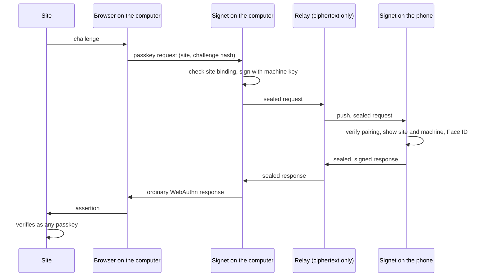

# Remote passkey approval: the phone signs, the computer relays

Status: design plus three tested slices, November 26, 2026. Created by
[Jeremy McEntire](https://perardua.dev). Build resumed **for this subsystem
only**, at Jeremy's direction; everything else in [open work](open-work.md)
stays paused.

What exists: the protocol (`signet-passkey`), a relay (`signet-passkey-relay`),
the computer side with its command line and browser host
(`signet-passkey-desktop`), and a Chromium extension
(`extensions/passkey-chromium`). A passkey has been created and used from a
page in real Chrome, through the extension, the local program and the relay,
with the site's side verified by an independent WebAuthn implementation
(webauthn-rs).

What does not exist: the phone app. In every test a simulator stands in for
the phone, with keys in ordinary memory. The computer side reaches a relay on
the same machine only, because its TLS client is not built. Nothing was
deployed and no real passkey was enrolled.

## The problem

A computer asks for a passkey. Its owner is 800 miles away with the phone that
holds it. Wi-Fi and Bluetooth are both on, and the sign-in still fails, because
the cross-device passkey flow requires the phone to be within Bluetooth range of
the computer that asked.

That proximity check is deliberate. It stops an attacker's computer, anywhere on
the internet, from getting a victim to approve a sign-in on it. It also assumes
the person sits next to the machine doing the work. Agents end that assumption:
the work runs on a machine at home, in an office or in a data center while the
owner is somewhere else.

The approval has to travel to the owner. The owner should not have to travel to
the machine.

## What cannot be done

A passkey held by the operating system (iCloud Keychain, Windows Hello) is
unlocked by the operating system checking the user locally, with a fingerprint,
face or device password. No interface lets a remote signal satisfy that check,
and none should. So an existing platform passkey cannot be approved from far
away. Signet has to be the authenticator.

## Design

| Role | What it is | What it holds |
|---|---|---|
| Authenticator | Signet on the phone | Passkey private keys, behind Face ID. Decides and signs. |
| Requester | Signet on the computer | A machine identity key. Holds no passkey key. Forwards requests, returns results. |
| Relay | Store-and-forward service | Nothing useful. Sees only sealed messages and which pairing they belong to. |
| Site | Any WebAuthn relying party | The public key, as with any passkey. Needs no change. |



The computer gets its requests one of two ways:

- **Operating-system passkey provider.** macOS 14 and later let a third-party app
  supply passkeys to Safari, Chrome and native apps; Windows 11 has an equivalent
  plugin interface, generally available since November 2025. The system hands the
  provider the site identifier and a hash of the client data, never the page.
- **Browser extension plus a local Signet process.** The extension takes over the
  page's passkey calls, the way password-manager extensions do, and passes them to
  Signet over native messaging. It works in any Chromium browser on any operating
  system, including one an agent drives on a Linux host.

The phone shows four things before Face ID: the site, the action (sign in, or
create a passkey), the account, and which paired machine is asking. It signs only
the request it showed.

## What replaces proximity

Bluetooth answered one question: is the machine asking one the owner is actually
using? These checks answer it without distance.

| Attack | What stops it |
|---|---|
| A stranger's computer asks the phone to sign in somewhere | Only paired machines can ask. Pairing is a one-time ceremony the owner performs; every request is signed by the machine's key and the phone rejects any other signer. |
| A phishing page on a paired machine asks for the real site's passkey | The site identifier must match the page's origin. The browser or OS enforces that in the provider path. In the extension path Signet enforces it itself, using the public-suffix list and the origin reported by the browser, never one supplied by the page. The phone repeats the check when it is given the origin. |
| The relay, or anyone on the network, reads, alters, replays or swaps messages | Messages are signed, then sealed to the recipient's key (HPKE, RFC 9180). The relay cannot read or forge them. Requests expire in two minutes and are accepted once. A response is bound to the digest of the exact request it answers. |
| The relay substitutes its own key while a new passkey is created | The response must be signed by the paired phone. The computer discards anything else before the site ever sees it. |
| A stranger fills the phone's mailbox, or reads it | Every relay request is signed by a device key. A mailbox accepts messages only from senders its owner has listed, and only its owner can read it. This limits nuisance; secrecy and authenticity never depend on the relay. |
| A page floods the phone with prompts | Sign-ins reach the phone only for sites that have a passkey there. Creating one requires that the person has interacted with the page. One page origin may send six requests a minute; the rest fail on the computer. |
| A page lies about which site it is | In the extension path the origin comes from the browser, through the extension's service worker. The script that runs inside the page is never asked. |
| A stored passkey is used for a different site | The phone signs only when the request's site identifier equals the one the passkey was created for. |
| Someone who glimpses a pairing ticket pairs in the owner's place | After pairing, both devices show a six-digit code derived from the two devices' keys. If another device answered the ticket, the codes differ and the owner revokes the pairing. |

## What it does not protect

- **A compromised paired machine** can ask for any site. The phone shows the site
  and the machine, and the owner can decline, but a tired owner may not. Requests
  from an agent should say so, and a short code shown on both ends is a candidate
  addition. In the extension path "the machine" means anything running as the
  owner's account: the machine key is a file that account can read, and any
  program can start the local process and name any origin. The operating-system
  provider path narrows this, because there the system states the site.
- **What happens after sign-in.** A session cookie on a compromised machine is
  outside this design, as it is for every passkey.
- **A lost or compromised phone.** See Keys, below.
- **Availability.** If the phone is off or unreachable, nothing signs. That is the
  intended failure.

## Keys

Every key in this subsystem is P-256, because that is the curve the phone's Secure
Enclave, the Mac's Secure Enclave and Windows TPMs hold. This departs from
Signet's Ed25519 identities and is confined to this subsystem.

- **Passkeys, hardware-bound.** Generated inside the phone's Secure Enclave and
  never exportable. Strongest. A lost phone loses them, so each account needs a
  second authenticator or its own recovery route.
- **Passkeys, portable.** An ordinary P-256 key encrypted under a Secure Enclave
  key. Weaker, but it can be backed up and exported. Imported passkeys are always
  this class, because the Secure Enclave cannot import a key that was created
  elsewhere.
- **Identity keys.** The phone and each machine have a signing key and a key
  for sealing. The phone's live in the Secure Enclave; a machine's can live in
  its own secure hardware where it has any.

Each passkey reports its class truthfully to the site through the standard
backup flags. Signature counters stay at zero, as synced passkeys do.

## Migrating existing passkeys

Mostly yes, with three limits.

1. **Apple, Google, 1Password, Bitwarden and similar passkeys can move.** iOS 26
   and macOS 26 added app-to-app transfer built on the FIDO credential exchange
   format. The phone app must be a registered credential provider that supports
   import. Developers report trouble getting a new app listed as a transfer
   destination, so this needs testing on a real device early.
2. **Moved passkeys are portable-class, not hardware-bound.** For the accounts
   that matter most, add a new Signet passkey on the site and delete the old one.
   Sites accept several passkeys per account.
3. **Some cannot move at all.** Hardware security keys and passkeys bound to one
   device's hardware (Windows Hello among them) have no export. Those accounts
   need a new Signet passkey added. Work single sign-on may also restrict which
   authenticators it accepts.

## Fit with Signet

- A passkey signature is Tier 3: live owner approval, no caching, no delegation.
  Nothing in this design signs without Face ID.
- It gives one concrete answer to the open "unlock/use" step in
  [client custody](client-asset-custody.md): the trusted client performs the
  approved operation and returns only the result. No key is released.
- The phone's signed response is the disclosure receipt the audit invariant
  requires: which machine asked, for which site, what was decided and when.
- This is for actions that should carry the owner's own signature. An agent's
  routine work should use its own scoped credential, not borrow the owner's
  passkey.

## Wire protocol

Two messages, each JSON. The sender signs the exact bytes sent, prefixed with a
domain and the recipient's fingerprint (the authority core's signing contract,
plus the recipient), then seals the result with HPKE (P-256, HKDF-SHA256,
AES-256-GCM).

- `SignRequest`: request id, pairing id, operation, site identifier, client-data
  hash, optional origin, allowed credential ids or new-account details, optional
  context, created and expiry times. Signed by the machine. The machine's name
  is not in the request: the phone shows the name recorded at pairing.
- `SignResponse`: request id, digest of the signed request, decision, and on
  approval the WebAuthn result. Signed by the phone.

The phone drops a request, without replying, unless the pairing is active, the
signature verifies, the time window holds and the id is new. It then refuses,
with a signed reply, when the site identifier is malformed or does not belong
to the origin it was given, when no stored passkey is for that site, or when
the site requires verification and the owner approved without it. Otherwise it
asks the owner. The computer rejects a response unless it is signed by the
paired phone and matches one pending request, which it then consumes.

Pairing uses a one-time ticket carrying a 256-bit secret, the issuer's public
keys and the relay's address, shown as a QR code or a string. The address is
part of what the reply authenticates, so both devices must have read the same
one. It is done once per machine, in person or
over a channel the owner already trusts, and ends with the owner comparing the
confirmation code on both devices. Either side can revoke a pairing.

The protocol crate keeps pairings, passkey records and the replay window in
memory. The local program stores the computer's pairings durably. Storing the
phone's passkeys is the phone app's job, and is not built.

## The relay

A mailbox, and nothing more. It holds sealed envelopes for a few minutes and
hands each to the device it is addressed to. It keeps everything in memory.

| Request | Who may make it | Purpose |
|---|---|---|
| `POST /v1/mailbox/{fingerprint}/poll` | The device with that fingerprint | Read its mailbox, acknowledge earlier messages, restate which senders it accepts. Waits up to 30 seconds for a message. |
| `POST /v1/mailbox/{fingerprint}/messages` | A sender that device has listed | Leave one sealed envelope, optionally in a named slot, for up to 330 seconds. |
| `PUT` / `GET /v1/rendezvous/{id}` | Anyone who read the pairing ticket | Leave, and collect once, the reply to a ticket. The id is derived from the ticket's secret. |
| `GET /v1/health` | Anyone | Liveness. |

- **A device is its key.** A mailbox is named by the fingerprint of a device's
  public keys. Each request carries those keys and a signature over the relay's
  address, the method, the path, the body, a timestamp and a nonce. The relay
  recomputes the fingerprint, so there are no accounts to create and none to
  take over. A repeated nonce is refused.
- **Senders are listed by the recipient.** A device names its paired devices on
  every read. The relay refuses anyone else, and gives the same answer whether
  the mailbox exists or not. Because the list arrives with every read, a relay
  that restarts relearns it and stores nothing on disk.
- **Answers go to slots.** A computer may have several requests waiting, each
  in its own process. The phone leaves each response in a slot derived from the
  request envelope, and each waiter reads only its slot.
- **Messages are offered until acknowledged.** A reader that loses a reply gets
  the message again. Both devices already refuse duplicates.
- **What the relay learns:** which fingerprints exchange messages, when, and how
  large they are. It cannot read, alter or forge a message.

**Where it runs.** Decided November 26, 2026: with Herald, as its own set of
routes inside the Herald server, not on Herald's customer accounts. Herald is
axum on tokio, as this relay is, so the relay's router mounts under a path
prefix. A device signs the path below that prefix, and the relay's address,
prefix included, is the audience in every signature. Whoever hosts it must
terminate TLS in front and limit requests per network address there: pairing
replies and first contact from a new device are the two things the relay
cannot attribute to a known key. Not done yet; see the build order.

## The computer side

`signet-passkey` is one program with two faces: a command line for the owner,
and the native-messaging host the browser starts for each passkey call.

```
signet-passkey init --name "Work laptop" --relay https://...
signet-passkey pair                  # shows a ticket, then asks for the code on the phone
signet-passkey status
signet-passkey sites add example.com # for a passkey created from another computer
signet-passkey new-passkeys off      # leave creation to the browser
signet-passkey browser install --extension-id <id>
```

Pairing ends with the owner typing the six digits the phone shows. The pairing
is saved only if they match what the computer computed, so a device that
answered the ticket in the owner's place is never recorded.

The extension has three parts. A script in the page's own world stands in front
of `navigator.credentials.create` and `.get` in the top-level document. A second
script, in the extension's isolated world, passes each call to the service
worker and shows a small notice while the phone is being asked. The service
worker attaches the page's origin as the browser reports it, starts the local
program, and returns its answer.

For each call the local program decides between the phone and the browser:

- **Creating a passkey** goes to the phone when the computer is paired and new
  passkeys are switched on, unless the site asked for a roaming security key or
  does not accept ES256.
- **Signing in** goes to the phone for sites recorded as having a passkey there.
  A site is recorded when a passkey is created for it through this computer, or
  by hand.
- **Everything else** is handed back, and the extension calls the browser's own
  implementation with the page's original arguments: sign-in through the
  autofill list, calls inside frames, options it cannot read, a page that has
  not been interacted with.

A denial, a timeout or an unreachable phone reaches the page as the same
`NotAllowedError` a dismissed browser prompt produces. A sign-in the phone has
no passkey for is handed back to the browser, so a passkey kept elsewhere still
works.

Known limits of this slice:

- The machine key is a file readable by the owner's account (mode 0600), not a
  key in the operating system's key store.
- The relay client speaks plain HTTP to a relay on the same machine. It refuses
  any other address until TLS is built.
- Cancelling on the computer does not reach the phone; the request there simply
  expires. The protocol has no cancel message yet.
- Requests go to the first paired phone. There is no chooser for several.
- The browser host is installed for macOS and Linux. Windows uses the registry
  and is not automated. Only Chrome for Testing 153 has been exercised.
- The extension is loaded unpacked; it is not packaged or published.

## Trying it on one machine

Everything below is local and uses the phone simulator, whose keys are in
memory and vanish when it exits. Do not register it with an account that
matters.

```
cargo build -p signet-passkey-relay -p signet-passkey-desktop --bins --examples
node scripts/passkey_browser_e2e.mjs          # the whole chain in Chrome, unattended
```

By hand: start `signet-passkey-relay`, run `signet-passkey init` and `pair`,
give the ticket to `target/debug/examples/phone_sim --ticket ...`, type the
code it prints, load `extensions/passkey-chromium` unpacked, and run
`signet-passkey browser install --extension-id <id>`.
`target/debug/examples/test_site` is a site to try it on.

## Build order

| Slice | Contents | State |
|---|---|---|
| 1. Protocol core | `signet-passkey`: messages, sealing, pairing, reference authenticator and requester, site-binding check, WebAuthn encoding, and what both devices say to the relay. | Done. |
| 2. Relay and local program | `signet-passkey-relay`; `signet-passkey` commands, settings and native-messaging host. | Done as a reference, tested over real HTTP on one machine. |
| 3. Browser extension | Chromium extension; end-to-end test in Chrome against a local site, with the simulator standing in for the phone. | Done; passes in Chrome for Testing 153. |
| 3a. Reach a real relay | TLS in the relay client. Mount the relay's routes in Herald. Machine key in the OS key store. | Next. Herald change waits on this work merging; deployment needs Jeremy's approval. |
| 4. Phone app | iOS app: Secure Enclave keys, Face ID, push, request screen, pairing by QR code. | Needs Xcode, an Apple developer account and a push key. Cannot be built or signed from a Linux host. The relay will also need to send the push. |
| 5. OS providers and import | macOS provider extension, Windows plugin, credential import on iOS. | Needs slice 4 and Apple's credential-provider entitlement. |

## Decisions for Jeremy

Settled:

- **First desktop integration:** the browser extension. Built.
- **Where the relay runs:** Herald, as its own routes (November 26, 2026).

Open:

1. **Default key class for new passkeys.** Proposed: hardware-bound, with a
   prompt to enroll a second authenticator.
2. **P-256 in this subsystem** instead of Ed25519. Built that way; reversible
   until a phone app ships.
3. **Who builds the phone app,** and whether it goes through a Chiron run on a
   Mac.
4. **The authenticator model identifier (AAGUID).** A provisional value is in
   the code. Sites record it when a passkey is created, so it must be fixed
   before the first real one.

One risk to test before relying on the macOS provider: an Apple engineer has
stated that credentials returned by a provider extension are, by Apple's
definition, synced passkeys, and that device-bound ones do not qualify. The
remote-signing path does not go through an iOS provider extension, and the
browser-extension path involves no Apple interface at all, but the Mac provider
returning a signature from a hardware-bound phone key should be confirmed on a
device.

## How it was checked

The same author wrote the code and its tests, so four outside checks were added.

- **An independent verifier.** webauthn-rs plays the site wherever a passkey is
  created or used: in the protocol tests, in the computer-side tests that run
  against a real relay over HTTP, and behind the test site the browser visits.
  It issues the challenges and verifies the results with its own code, so a
  misunderstanding shared by the phone and computer sides cannot pass.
- **A real browser.** `scripts/passkey_browser_e2e.mjs` starts the relay, the
  test site, the phone simulator and Chrome with the extension, pairs by ticket
  and typed code, and has the page call the standard API. It checks that the
  site verified a registration and a sign-in approved on the phone, that the
  page received objects of the standard types, that a denial arrives as
  `NotAllowedError`, and that calls not meant for the phone still reach the
  browser's own authenticator. It needs a browser, so it is not part of
  `make check`; run it with `make passkey-e2e`.
- **Disabled checks must break a test.** `scripts/passkey_mutation_check.py`
  switches off each of 50 security checks in turn, across the three crates, in
  a temporary copy of the workspace, and runs the tests. 49 cause a test to
  fail. The one that does not is the sender fingerprint in the HPKE context, a
  second barrier behind the signature with no test of its own. The script fails
  if a check stops being covered or its pattern stops matching the source.
- **Dependencies checked against their sources.**
  `scripts/dependency_provenance_check.py` looks up every package in
  `Cargo.lock` in OSV, which carries the RustSec database, GitHub advisories and
  the OpenSSF malicious-packages list. For packages added since `main`, or for
  all of them with `--all`, it also confirms that each published file is
  identical to the public repository at the commit the package records, that
  the registry and local checksums match the lockfile, and that the release is
  at least 14 days old. Run with `--all` on November 26, 2026: of 348 packages,
  318 matched their source exactly, and the other 30 were examined by hand and
  recorded, with what was found, in
  `scripts/dependency_provenance_reviewed.json`. None of the packages this work
  added runs code at build time. Three releases under a week old were pinned
  back to aged ones (hpke 0.15.1, sha2 0.11.1, psl 2.1.252); url 2.5.9 and
  form_urlencoded 1.2.3 are kept despite their age because they fix an advisory,
  with the reason recorded in `scripts/dependency_age_exceptions.json`.

None of this replaces an independent review or a separate tester. The
simulator proves nothing about hardware custody or about what a person will
approve when tired. `make check` passes, and the workspace tests pass on both
stable Rust and the 1.88 minimum.

## Sources

- Apple, [ASCredentialImportManager](https://developer.apple.com/documentation/authenticationservices/ascredentialimportmanager) (credential import).
- Apple developer forums: [provider extensions, hybrid transport and device-bound credentials](https://developer.apple.com/forums/thread/829541); [Chrome and the credential identity store](https://developer.apple.com/forums/thread/804344); [transfer-destination listing problem](https://developer.apple.com/forums/thread/819382).
- Microsoft, [plugin passkey manager support](https://learn.microsoft.com/en-us/windows/apps/develop/security/third-party) and [general availability note](https://techcommunity.microsoft.com/blog/windows-itpro-blog/windows-11-expands-passkey-manager-support/4467572).
- FIDO Alliance, [credential exchange on iOS 26](https://fidoalliance.org/biometric-update-bitwarden-among-first-to-implement-fido-credential-exchange-standards-on-ios-26/).
- RFC 9180 (HPKE); W3C Web Authentication Level 3.

Platform behavior was checked on November 26, 2026 and must be rechecked before
any integration ships.
